<div align="center">

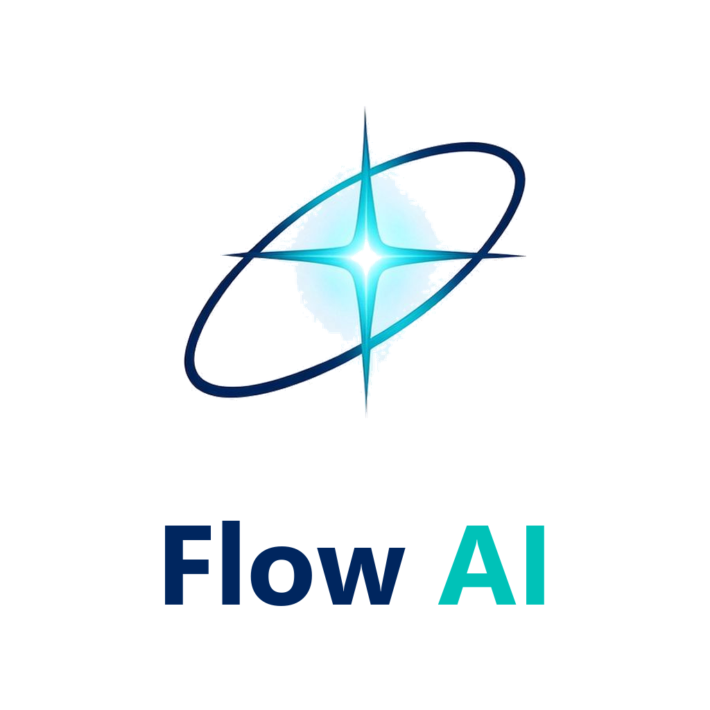

# Flow · AI 原生跨境出口电商平台

### 一套代码，两个世界：买家商城 + 卖家 AI 工作台

**从开店、上架、获客、成交、客服到复盘，全链路都在这里。**

[](CHANGELOG.md)
[](LICENSE)
[](https://www.typescriptlang.org/)
[](https://react.dev/)
[](https://nestjs.com/)
[](https://www.postgresql.org/)
[](server)
[](CONTRIBUTING.md)

[**90 秒演示视频**](docs/video/demo.mp4) · [**产品截图**](docs/screenshots) · [**架构说明**](docs/ARCHITECTURE.md) · [**部署指南**](docs/DEPLOY.md) · [**OpenAPI**](/api/openapi.json)

**镜像 · Mirrors**：[GitHub](https://github.com/X33834/Flow) · [Gitee](https://gitee.com/badhope/Flow) · [GitCode](https://gitcode.com/badhope/Flow)

</div>

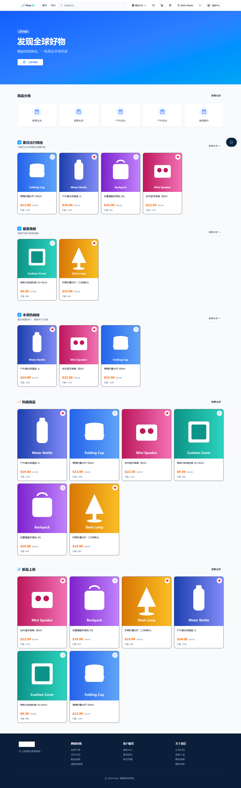

---

## 这是什么？

**Flow 是一个可以直接跑起来的开源跨境电商平台。** 它不是演示壳子：买家用真实流程下单付款，卖家在真实数据上运营，AI 调用真实模型并把结果写回业务系统。

| | 买家商城 Buyer Storefront | 卖家 AI 工作台 Seller Workbench |
|---|---|---|
| **定位** | 面向海外买家的 B2C 出口商城，四语言（zh/en/es/pt） | 面向卖家的运营中枢，AI 副驾 + 真实数据 |
| **核心** | 搜索 / 筛选 / 多规格 SKU / 购物车 / 优惠券 / 支付 / 物流 / 退款 / 评价 | 看板 / 商品 / 订单 / 退款 / 集合 / 优惠券 / CMS / 审计 / AI |
| **AI** | AI 导购（按需求推荐、加购需确认） | 5 个专业 Agent + 工具调用副驾（人工审批后执行） |

> **不配置任何 AI Key 也能完整使用**：所有非 AI 功能正常运行；AI 端点诚实返回「请填写模型」，绝不返回假数据。

---

## 一眼看到差异化

大多数开源电商项目要么只有商城，要么只有后台。Flow 的独特之处在于**AI 不是装饰，而是写进业务链路的一等公民**：

### 1. AI 运营副驾：会干活，但不会乱干

卖家说一句「把低库存商品清仓」，副驾会：查低库存 → 建清仓券 → 下架滞销品，把**多步动作合成一个待审批批次**，一次批准按序执行，失败即停。写操作在模型循环内**永不执行**，只落 `pending` 动作，必须人工批准。

```
卖家自然语言
   └─ Agent 规划多步工具调用
        ├─ 只读工具：直接查本店真实数据
        └─ 写工具：落 copilot_actions(status=pending)
              └─ 卖家点「批准」→ 走既有业务服务（状态机/库存/积分/审计一致）
```

- **12 个工具**：店铺概况、订单、商品、低库存、待批退款（读）；改订单状态、批/拒退款、上下架、建券、建草稿、回复咨询（写）
- **参数强校验**：每个工具声明类型/枚举/范围/长度，未知参数一律拒绝，防模型幻觉与参数注入
- **归属校验**：读工具按卖家隔离，写工具执行前二次校验归属，管理员可跨店
- **全链路留痕**：对话、工具结果、动作、执行结果逐条落库

### 2. 5 个真实 Agent，不是 5 个按钮

| Agent | 做什么 | 关键实现 |
|---|---|---|
| **Copywriter** | 商品标题 / 卖点 / 长描述 / SEO 关键词 | 强制 JSON，写回多语言字段 |
| **Support** | 智能客服 | FAQ 政策匹配 + 商品检索 + 订单状态摘要，先查真实数据再回答 |
| **Trend** | 趋势报告 | SQL 聚合近 30 天销量 + LLM 解读，报告落库可回看 |
| **Select** | 选品建议 | 类目 + Top 20 热销 + 90 天需求缺口 → 结构化推荐 |
| **Translation** | 12 种语言翻译 | 统一网关，多语言字段回写 |

外加**自定义 Agent**：提示词模板 + `{{input}}` + JSON/文本输出 + temperature/maxTokens，保存即可试跑，用量独立统计。

### 3. 买家侧 AI 导购

独立工具集（只有买家能力，没有任何卖家工具），推荐只基于 `status=active` 且有库存的商品；加购必须先确认；零结果搜索自动记录为**需求缺口**，回流给卖家的选品 Agent。

---

## 功能全景

### Buyer · 买家端

| 模块 | 能力 |
|---|---|
| 首页 | Hero、分类导航、人工运营楼层（精选集合自动成楼层）、热销、新品、**最近浏览** |
| 商品 | 列表（分类/价格/排序/分页/搜索联想）、详情（多图、SPU→SKU 变体、评分、**相关推荐**）、收藏 |
| 购物车 | 游客/登录双轨、跨设备迁移码、登录自动合并 |
| 结算 | 地址簿预填、运费实时报价、优惠券校验、服务端重算金额、Stripe / PayPal / Demo |
| 订单 | 状态时间线、物流轨迹、待付款补付、退款申请、确认收货后评价（支持图片） |
| 账户 | 注册/登录/Google OAuth、地址簿、积分与等级 |
| 内容 | CMS 页面（About / FAQ / 政策）、多语言、SEO |

### Seller · 卖家端

| 模块 | 能力 |
|---|---|
| AI 副驾 | 工具调用、多步计划批次审批、店铺巡检、定时巡检、通知（Webhook/邮件）、通知预览 |
| 看板 | GMV / 订单 / 访客 / 商品 / 今日数据 / 30 天趋势 / 分类占比（全部按本店聚合） |
| 商品 | CRUD、SPU+SKU、CSV 导入/导出、批量上下架、**上架门禁**（6 项完整性校验）、AI 文案、质量抽检 |
| 订单 | 列表筛选、详情、状态流转、分批发货、物流登记 |
| 退款 | 列表/详情、审批（原路退回）、拒绝、并发抢占防重复打款 |
| 营销 | 优惠券（百分比/固定/包邮，范围与限次）、集合（手动/智能）、CMS 富文本 |
| 运营 | 咨询管理、审计日志（按卖家隔离）、运费模板、AI 分析中心（模型设置/用量/报告/自定义 Agent） |

---

## 产品截图

### 买家商城

| 首页（中文） | 首页（英文） |
|:---:|:---:|
|  | 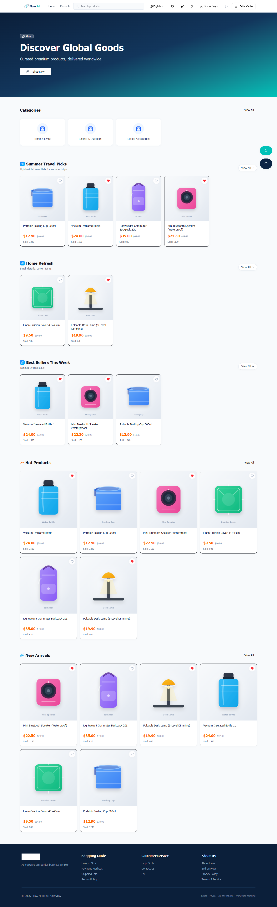 |
| **商品列表** | **商品详情** |
| 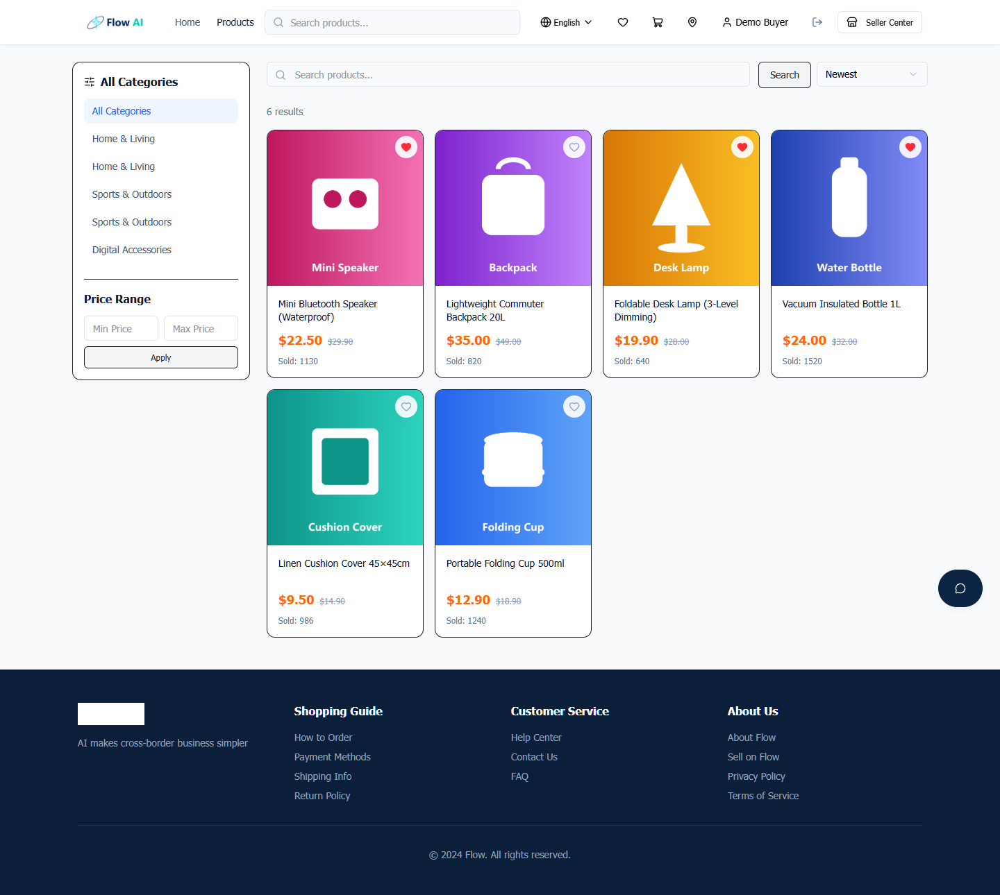 | 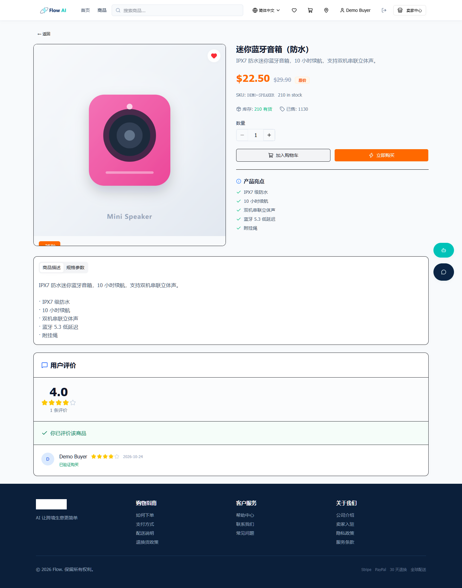 |
| **购物车** | **结算** |
| 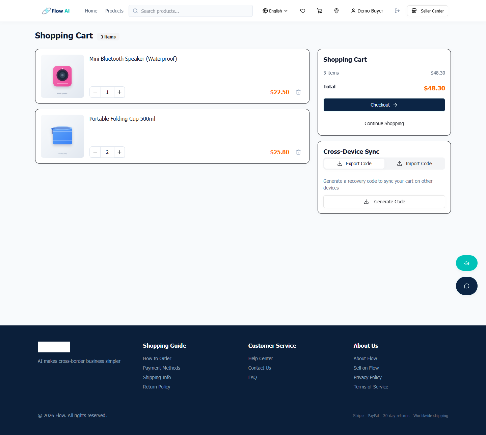 | 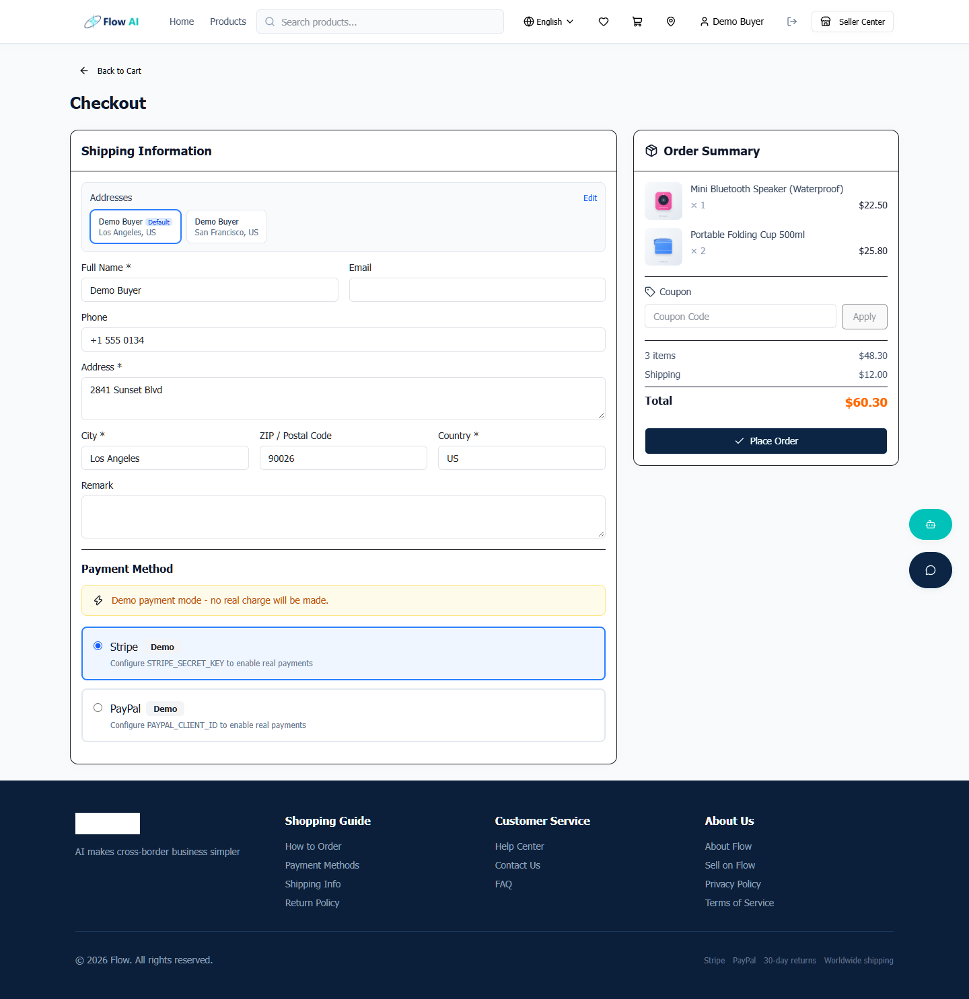 |
| **订单跟踪** | **运营楼层** |
| 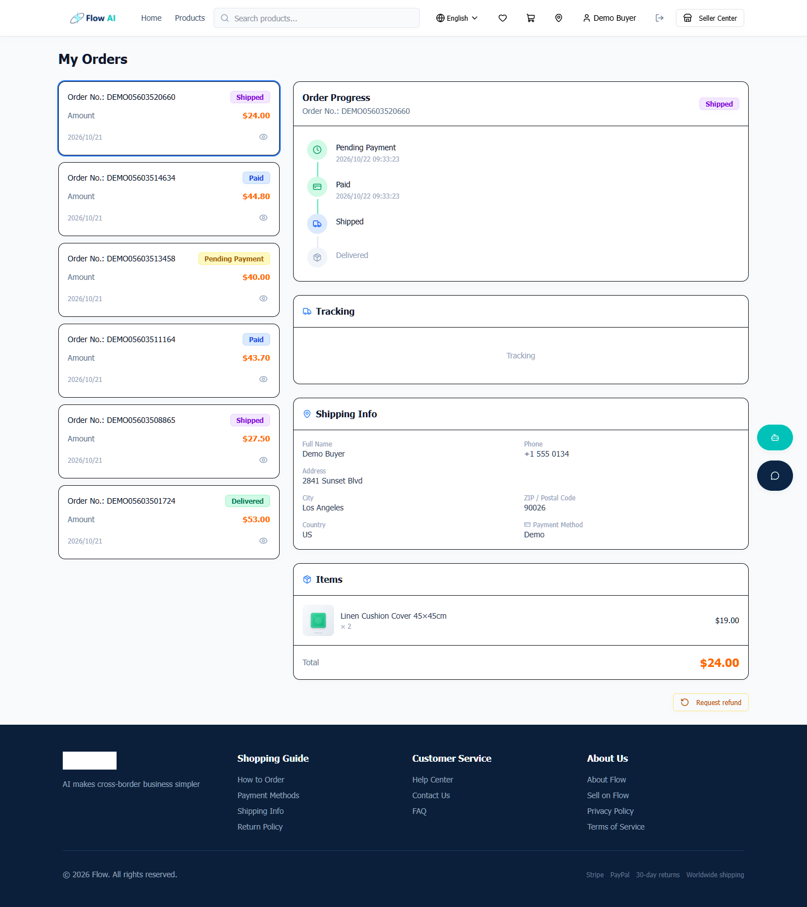 | 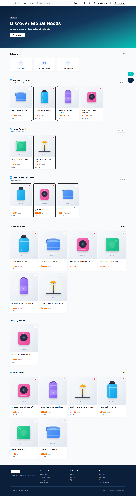 |

### 卖家工作台

| 数据看板 | AI 运营副驾 |
|:---:|:---:|
| 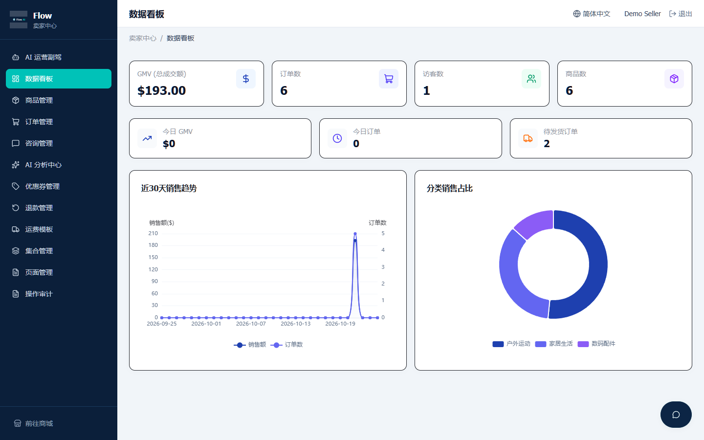 | 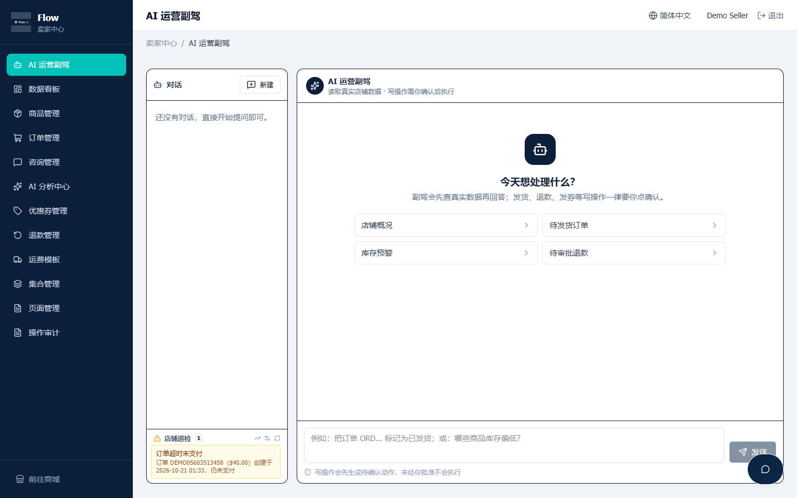 |
| **商品管理** | **订单管理** |
| 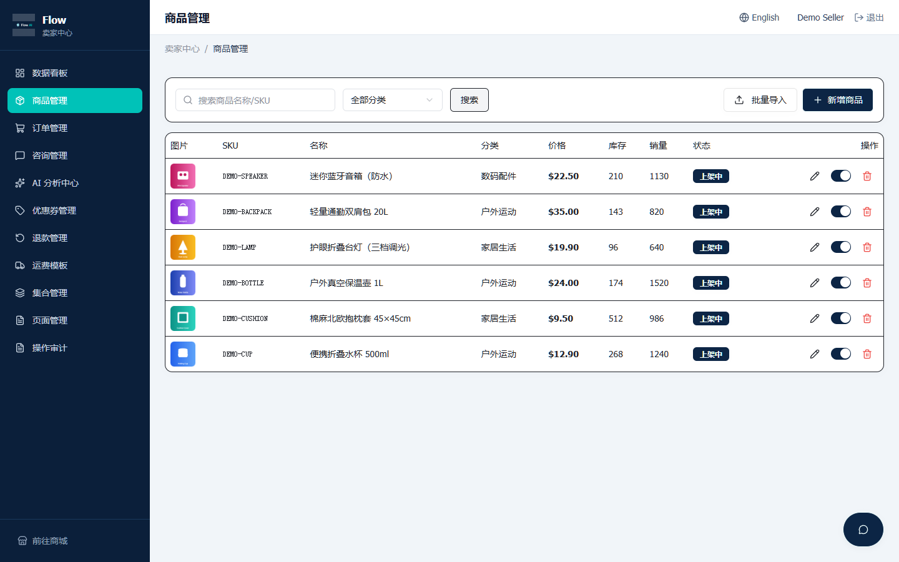 | 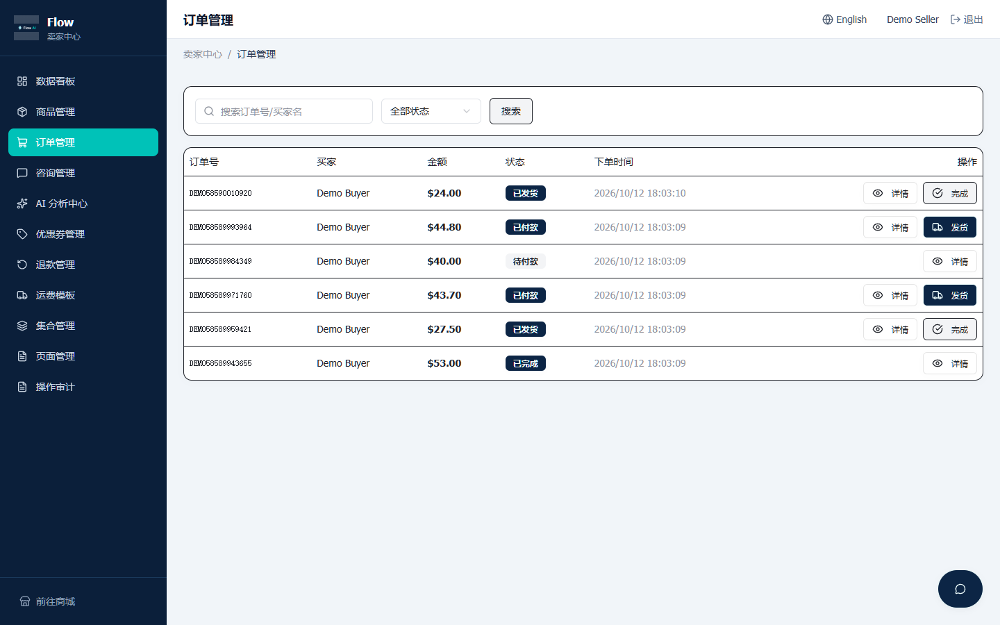 |
| **AI 分析中心** | **退款管理** |
| 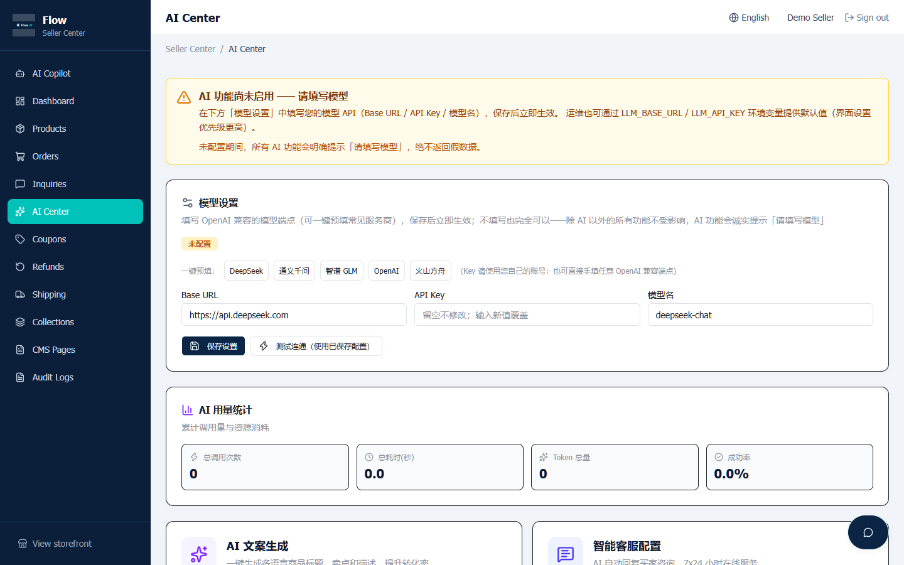 | 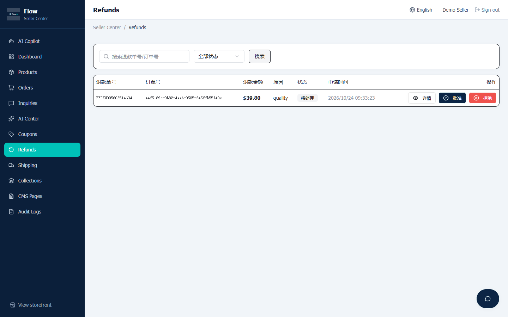 |

> 全部 **30 张**页面截图见 [`docs/screenshots/`](docs/screenshots)（买家 15 + 卖家 14 + 移动端 1）；截图与演示视频均由 `npm run capture:all` 自动生成，可随时重录。

---

## 快速开始

### 方式一：Docker（推荐）

```bash
git clone https://github.com/X33834/Flow.git
cd Flow
cp .env.example .env          # 至少填写 JWT_SECRET
# 可选：SEED_DEMO_DATA=true 首次启动写入演示账号/商品/优惠券
docker compose up -d --build
```

打开：
- 买家商城 <http://localhost:3000/>
- 卖家工作台 <http://localhost:3000/seller/dashboard>

演示账号：`seller@example.com / seller123`、`buyer@example.com / buyer123`，优惠码 `TEST10`。

### 方式二：本地开发

```bash
npm ci
cp .env.example .env   # 填 DATABASE_URL 与 JWT_SECRET（NODE_ENV=development）
npm run db:migrate
npm run dev            # Vite + NestJS 同时启动
```

### 方式三：命令行（集成/运维）

```bash
FLOW_BASE=http://127.0.0.1:3000 npm run cli -- health
FLOW_BASE=http://127.0.0.1:3000 npm run cli -- products --limit 5
FLOW_BASE=http://127.0.0.1:3000 npm run cli -- openapi openapi.json
```

---

## AI 配置

模型配置在 **卖家工作台 → AI 分析中心 → 模型设置** 中填写，保存即生效，无需重启：

| 字段 | 说明 |
|---|---|
| Base URL | 任意 OpenAI 兼容端点：DeepSeek、火山方舟、OpenAI、通义、智谱…… |
| API Key | 仅存数据库（不回显明文，掩码展示） |
| 模型名 | 如 `deepseek-chat`；推理模型会自动提高 token 预算 |

优先级：**界面设置 > 环境变量 `LLM_*` > 未配置（诚实报错）**。

> 内置本地模拟器 `npm run mock:providers` 同时扮演 Stripe / PayPal / LLM，带真实签名回调，无需任何真实凭据即可跑通 AI 与支付全链路。

---

## 工程与质量

| 维度 | 现状 |
|---|---|
| 类型 | TypeScript strict，前后端共享 `shared/api.interface.ts` 契约 |
| 测试 | **166 个单元测试**（金额/退款/运费/状态机/验签/租户/查询/SEO/通知） |
| E2E | **6 套全链路冒烟**：业务工作流 16 步、无 Key 降级、交易 19 步、渠道 18 步、副驾 19 步、导购 9 步 |
| CI | GitHub Actions：lint → typecheck → test+coverage → build → Postgres E2E |
| 安全 | HttpOnly Cookie JWT、CSRF 头校验、按端点限流、Stripe/PayPal 验签、租户隔离、SSRF/重放防护 |
| 可观测 | 请求 ID、全局异常脱敏、结构化错误、AI 用量计量 |
| 可集成 | OpenAPI 3.1（`/api/openapi.json`）、`sitemap.xml`、`robots.txt`、`llms.txt` |

```bash
npm run lint          # ESLint
npm run type:check    # 前后端类型
npm test              # 单元测试
npm run smoke:all     # 一键全量 E2E（embedded-postgres，无需 Docker）
npm run build         # 生产构建
```

---

## 架构

```
┌──────────────────────────── Browser ────────────────────────────┐
│  React 19 + Vite + Tailwind + shadcn/ui + ECharts                │
│  Buyer Storefront  /            Seller Workbench  /seller/*      │
└───────────────────────┬──────────────────────────────────────────┘
                        │ HttpOnly JWT cookie · X-Requested-With
┌───────────────────────▼──────────────────────────────────────────┐
│ NestJS 12 (Express 5) · ValidationPipe · RolesGuard              │
│ Auth · Products · Cart · Orders · Payments · Refunds · Coupons    │
│ Shipping · Collections · CMS · Reviews · Inquiry · Dashboard     │
│ AI (5 Agents + Gateway) · Copilot (12 tools + approvals)         │
│ Shopper guide · SEO · Audit · Health                             │
└──────────┬──────────────────────────────┬────────────────────────┘
           │                              │
   ┌───────▼────────┐           ┌─────────▼──────────────────────┐
   │ PostgreSQL 16  │           │ OpenAI-compatible LLM endpoint │
   │ Drizzle ORM    │           │ Stripe · PayPal · 17TRACK      │
   │ pg_trgm search │           │ Google OAuth                   │
   └────────────────┘           └────────────────────────────────┘
```

详见 [docs/ARCHITECTURE.md](docs/ARCHITECTURE.md)（表结构、AI 网关、Copilot 协议、安全模型）。

---

## 对标与设计取舍

Flow 的定位是「AI 原生跨境出口电商」，对标开源 commerce 平

| 参照 | 借鉴了什么 | 为什么没有照搬 |
|---|---|---|
| **Medusa / Saleor / Vendure** | 模块边界、多租户、事件驱动、可组合 commerce | 不引入 GraphQL/重型容器，保持 REST + 单进程可部署 |
| **Shopify Hydrogen / Vercel Shop** | 店面 SEO、sitemap/robots、可预测搜索、性能预算 | 不绑定托管平台，Vite SPA + 服务端 SEO 注入 |
| **Dify / FastGPT** | Agent 配置体验、用量面板、知识库式上下文 | 只吸收 AI 产品化交互，不做通用 Agent 平台 |
| **Agentic commerce（UCP / ACP / AP2）** | `llms.txt`、机器可读 API、细粒度能力边界 | 支付授权协议尚早，先落地只读发现层 + 人工审批写操作 |

**刻意不做的**：多租户 SaaS 计费、插件市场、GraphQL 重写。这些会稀释「审批式 Copilot」这一真实差异化。

---

## 文档

| 文档 | 内容 |
|---|---|
| [docs/ARCHITECTURE.md](docs/ARCHITECTURE.md) | 架构、数据库表、AI 网关、Copilot 协议、安全模型 |
| [docs/AI-AGENTS.md](docs/AI-AGENTS.md) | 5 个 Agent、自定义 Agent、Copilot 工具与降级行为 |
| [docs/DEPLOY.md](docs/DEPLOY.md) | 部署、密钥清单、备份升级、排障 |
| [docs/RELEASE_NOTES.md](docs/RELEASE_NOTES.md) | v1.21.1 发布说明、升级注意与已知边界 |
| [CHANGELOG.md](CHANGELOG.md) | 版本历史 |
| [CONTRIBUTING.md](CONTRIBUTING.md) | 贡献流程与代码规范 |
| [SECURITY.md](SECURITY.md) | 安全策略与漏洞报告 |

---

## Roadmap

| 状态 | 内容 |
|---|---|
| ✅ v1.21 | 租户隔离加固、支付/退款幂等、SEO 注入、OpenAPI、CLI、批量运营、多语言与可访问性；v1.21.1 统一仓库名与 CI 全绿 |
| 🔜 下一阶段 | Region/多币种与税费、facets 聚合搜索、异步导出中心、MCP 只读服务端、事件总线与签名 webhook |
| 💡 探索 | 多店铺 SaaS、插件体系、按成交抽佣 |

---

## 贡献

欢迎 Issue / PR / 文档修正。开始前请阅读 [CONTRIBUTING.md](CONTRIBUTING.md) 与 [CODE_OF_CONDUCT.md](CODE_OF_CONDUCT.md)。

如果这个项目对你有帮助，**Star** 是最好的支持。

## License

[MIT](LICENSE) © 2026 Flow
