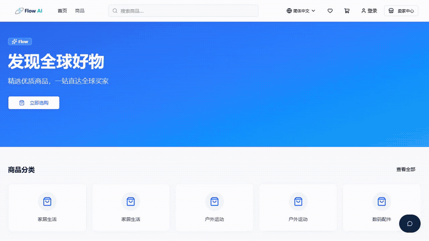
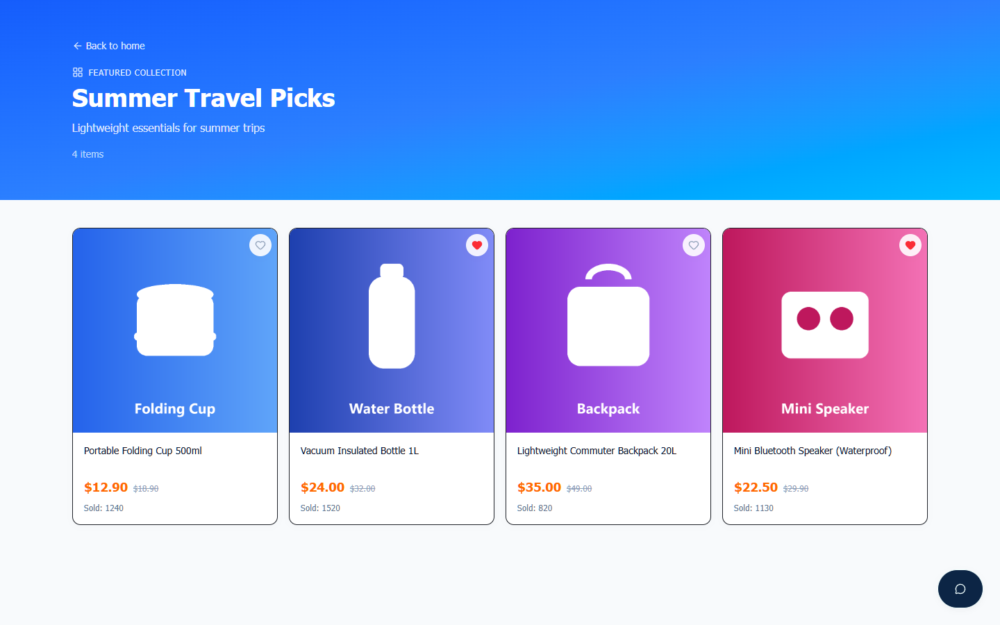
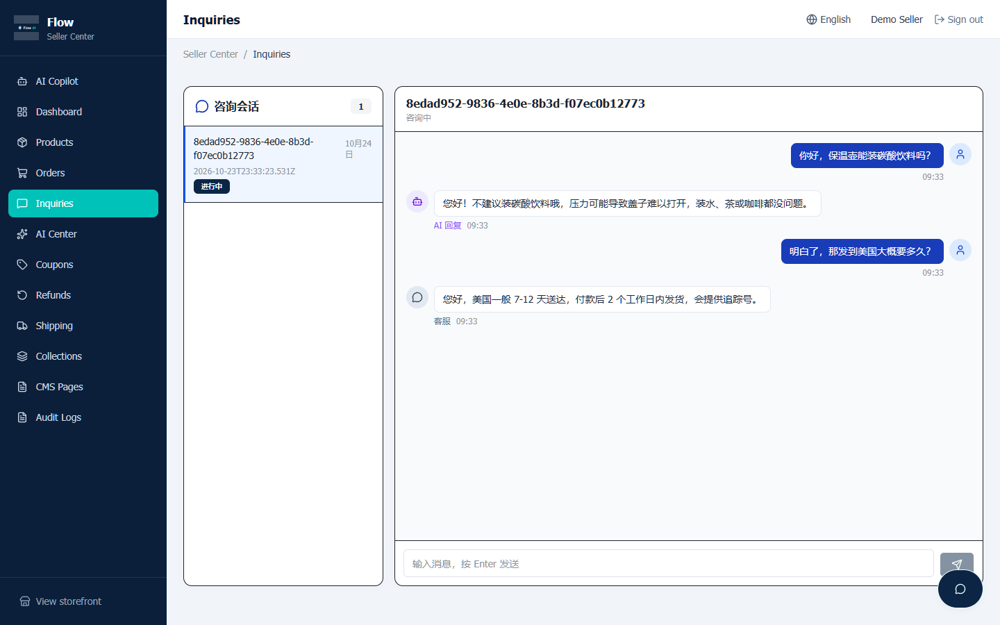

<div align="center">


# Flow

### 让跨境生意更简单 · Cross-Border Commerce, Simplified

#### *一个简洁的出口电商平台 · One clean platform for cross-border selling*

买家商城 + 卖家 AI 工作台双端一体，5 个 AI Agent 真实驱动商品文案、智能客服、趋势分析、选品建议与多语言翻译。

One codebase, two experiences — a B2C buyer storefront and a seller AI workbench, powered by 5 real AI Agents for copywriting, support, trend analysis, product selection and translation.

[](https://github.com/X33834/GlobalEcom-AI)
[](https://gitee.com/badhope/GlobalEcom-AI)
[](https://gitcode.com/badhope/GlobalEcom-AI)
[](https://github.com/X33834/GlobalEcom-AI/releases/tag/v1.18.0)
[](https://github.com/X33834/GlobalEcom-AI)
[](https://github.com/X33834/GlobalEcom-AI/actions)
[](LICENSE)
[]()
[](CONTRIBUTING.md)

</div>

---

**Flow** 是一套 **AI 原生的出口电商全栈平台**，面向跨境卖家提供"开店 → 上架 → 获客 → 成交 → 客服 → 复盘"的完整闭环。平台采用买家商城（B2C）与卖家 AI 工作台双端同仓架构，内置 **5 个真实调用大模型的 AI Agent**，帮助卖家以更低成本完成商品文案生成、多语言翻译、智能客服、趋势分析与选品决策。

**Flow** is a full-stack, AI-native cross-border e-commerce platform delivering the complete loop: *launch → list → attract → convert → support → review*. With a buyer storefront and a seller AI workbench in one monorepo, its 5 AI Agents help sellers cut cost and effort in copywriting, translation, customer support, trend analysis and product selection.

- **品牌定位 / Positioning**：出口电商平台 · Cross-Border Commerce Platform
- **主传播语 / Tagline**：让跨境生意更简单 · Cross-Border Commerce, Simplified
- **主色 / Brand Colors**：深海军蓝 `#0B1F3A` + 科技青 `#00C2B8`
- **当前版本 / Version**：v1.18.0（[CHANGELOG.md](CHANGELOG.md)）

---

## 演示 · Demo

**[▶ 观看 90 秒使用演示（docs/video/demo.mp4）](docs/video/demo.mp4)** — 买家浏览下单全流程 + 卖家 AI 工作台操作



> 视频由 `npm run capture:video` 自动录制（CDP 抓帧 + ffmpeg 合成，无需人工剪辑）；
> 截图由 `npm run capture` 自动生成（Puppeteer 全页截图，含真实演示数据）。

---

## 产品截图 · Screenshots

| 买家商城 Buyer Storefront | 卖家 AI 工作台 Seller AI Workbench |
|:---:|:---:|
|  |  |
| 运营楼层 · 分类导航 · 多语言（zh / en / es / pt） | GMV / 订单量 / 访客数，SQL 真实聚合 + ECharts |
|  |  |
| 卖家标记「首页推荐」的集合自动成为楼层 | 模型设置（5 家一键预填）· 用量统计 · 我的 Agent |
|  |  |
| 集合内全部上架商品，可点进详情 | 变体 SKU · 库存 · CSV 批量导入 · 上下架 |
|  |  |
| 地址簿预填 · 运费报价 · 优惠券 · 服务端重算金额 | 审批退款 · 原路退回 · 库存/销量/积分回补 |
|  |  |
| 订单列表 · 物流时间线 · 退款申请 | 买家会话与 AI 回复，卖家可直接接管 |

> 全部 **27 张**页面截图（买家 15 + 卖家 12）见 [`docs/screenshots/`](docs/screenshots/)。

---

## 核心功能 · Features

### 买家商城（B2C）· Buyer Storefront

- **浏览与搜索**：首页推荐、**人工运营楼层**（精选集合自动成为首页楼层，可点进集合详情页）、分类导航、筛选/排序/分页、关键词搜索（`pg_trgm`）
- **商品详情**：图片画廊、多规格选择（颜色/尺码等 SPU→SKU 变体体系）、加购/立即购买
- **购物车**：增删改、数量调整、价格实时计算；匿名购物车支持**跨设备迁移码恢复**
- **下单与支付**：收货地址簿、**运费模板**（按重量/件数/地区/满额包邮）、优惠券核销、Stripe / PayPal / Demo
- **订单跟踪**：状态时间线、物流轨迹、**退款申请**（卖家审批 → 原路退回）、带图评价
- **会员体系**：积分赚取 / 消费、等级（bronze / silver / gold）
- **多语言**：zh / en / es / pt 四语言，商品双语展示
- **AI 导购**：买家侧 Agent，按需求推荐在售商品、读详情/购物车，加购需买家确认
- **CMS**：自定义页面（About、FAQ 等）

### 卖家 AI 工作台 · Seller AI Workbench

- **运营看板**：GMV / 订单量 / 访客数，SQL 真实聚合 + ECharts
- **商品管理**：CRUD、上下架、**SPU/SKU 变体体系**、**CSV 批量导入**（papaparse 解析）
- **订单管理**：列表、状态流转、**分批发货**（Fulfillment）、物流录入
- **退款与售后**：审批退款（通过 → 自动触发 Stripe/PayPal 原路退）、拒绝回复
- **商品集合**：手动精选楼层 / 智能收集（按条件自动聚合）、首页展示
- **运费模板**：按重量/件数计费、地区加价、满额包邮
- **优惠券**：百分比 / 固定 / 包邮三种，限定商品/分类/用户，批量生成
- **客户管理**：地址簿、收货信息、购买历史
- **CMS 页面**：富文本编辑首页 Banner / About / FAQ
- **咨询管理**：买家会话列表与回复
- **AI 运营副驾**：自然语言下达运营指令，Agent 调工具查真实数据、发起写操作，**人工确认后执行**
- **AI 分析中心**：5 个 Agent 入口 + 调用用量统计（token / 耗时 / 成功率）
- **操作审计日志**：操作前后值 diff + IP，筛选回看

---

## AI Agent：内置 5 个 + 自定义无限个 · All Real, No Fake

**模型配置由卖家自己填**：登录卖家工作台 →「AI 分析中心 → 模型设置」填写 Base URL / API Key / 模型名，保存即生效（无需重启）；
环境变量 `LLM_*` 仅作为无界面部署的引导默认值，**界面设置优先级更高**。未配置期间所有 AI 功能统一提示「请填写模型」，绝不返回假数据。

内置 5 个专业 Agent（只读），另可在「我的 Agent」中创建任意数量的自定义 Agent（系统提示词 + `{{input}}` 模板 + 文本/JSON 输出 + temperature/maxTokens），保存后即刻试跑，用量独立计入统计。

所有 Agent 均为**真实 LLM 调用**（OpenAI 兼容协议），统一经 `ai-gateway` 收口；未配 key 时诚实报错 400，**绝不返回假数据**。

| Agent | 职责 · Responsibility | 模型 · Model | 关键实现 |
|---|---|---|---|
| **CopywriterAgent** | 商品文案生成（标题 / 卖点 / 长描述 / SEO 关键词） | DeepSeek-chat | 强制 JSON 输出，写回商品多语言字段 |
| **SupportAgent** | 智能客服 | DeepSeek-chat | 关键词匹配 + FAQ 政策匹配 + 订单状态摘要，全部真实查询不编造 |
| **TrendAgent** | 趋势分析报告 | DeepSeek-reasoner | SQL 聚合近 30 天销售数据 + LLM 解读，落库可回看 |
| **SelectAgent** | 选品建议 | DeepSeek-chat | 类目 + Top 20 热销 + 趋势摘要 → JSON 推荐 |
| **TranslationAgent** | 多语言翻译 | DeepSeek-chat | 支持 **12 种语言**（zh/en/es/pt/fr/de/it/ja/ko/ru/ar/th） |
| **自定义 Agent** | 用户自建（任意数量） | 同左 | 「AI 分析中心 → 我的 Agent」：提示词模板 / 文本或 JSON 输出 / 即时试跑 / 独立用量 |

> 详细输入输出、降级行为与环境变量说明见 [docs/AI-AGENTS.md](docs/AI-AGENTS.md)。

---

## AI 运营副驾：让 Agent 真正替你干活 · Copilot with Human-in-the-Loop

前 5 个 Agent 只产出内容，**运营副驾（Copilot）直接操作店铺**：卖家说人话，Agent 调工具读真实数据，需要改动时先生成"待确认动作"，卖家点批准才执行。

- **11 个工具**：5 个只读（店铺概况 / 订单 / 商品 / 低库存 / 待审批退款）+ 6 个写操作（改订单状态 / 批准退款 / 拒绝退款 / 商品上下架 / 建优惠券 / 回复咨询）
- **多步计划**：一句"清库存促销"自动串起「查低库存 → 建清仓券 → 下架商品」，多项动作共享批次、一次批准整批执行（失败即停）
- **店铺巡检**：常驻面板自动识别低库存 / 超时退款 / 未支付订单 / 长期未签收，点一条即可让副驾接手；阈值可在面板内调整
- **导购转化漏斗**：打开 → 推荐 → 加购 → 下单 四阶段转化率 + 买家热搜词，下单阶段联真实订单而非推断
- **需求缺口闭环**：导购搜不到的词自动记录，可一键交给副驾分析或**一键生成草稿商品**（审批后创建，默认 draft），并作为 SelectAgent 选品建议的真实需求输入
- **商品级漏斗**：每个商品"被推荐 → 加购 → 下单"的会话数与转化率，快速定位"推荐了但没人买"的商品
- **定时巡检**：可配置间隔的后台巡检（默认关闭，零新依赖），只提醒新增告警
- **巡检通知**：Webhook 推送到飞书/企业微信/钉钉/Slack；只在新告警时打扰；指数退避重试 + 熔断保护
- **上架门禁**：草稿商品必须通过 6 项完整性检查（标题/图片/售价/库存/描述/分类）才能上架，缺项直接提示
- **在售商品体检**：一键扫描历史在售商品，列出信息不完整项
- **通知多通道**：Webhook（飞书/企微/钉钉/Slack，markdown 排版）+ SMTP 邮件（HTML 表格），主题模板可配
- **一键补全文案**：体检出的不完整商品可批量生成英文标题/卖点/描述/SEO
- **草稿 AI 补全**：新建草稿商品自动生成英文文案与 SEO 关键词
- **人工审批门禁（fail-closed）**：写工具在模型循环内**永不执行**，只落 `copilot_actions(pending)`；只有会话所有者点"批准执行"才经既有业务服务落地（订单状态机、库存回补、积分回滚、审计日志与手动操作完全一致）
- **参数强校验**：每个工具声明 JSON Schema 式参数（类型 / 枚举 / 范围 / 正则 / 长度），未知参数一律拒绝，防模型幻觉与参数注入
- **全链路可回看**：对话、工具结果、动作与执行结果逐条落库，待确认数量在会话列表可见
- **诚实降级**：未配置模型时直接 400 提示，不伪造任何执行结果

```
卖家：把订单 ORD20261021ABC 标记为已发货
  └─ Agent → update_order_status（参数校验通过）
       └─ 落 copilot_actions(status=pending)，不执行
            └─ 卖家点「批准执行」→ OrdersService.updateStatus（状态机 + 审计）
```

> 无界面联调：`npm run mock:providers` + `npm run smoke:copilot`（读工具 → 待审批 → 批准执行 → 拒绝无副作用 → 越权 403 全链路断言）。详见 [docs/AI-AGENTS.md](docs/AI-AGENTS.md#6-copilot--ai-运营副驾)。

---

## 技术栈 · Tech Stack

| 层 · Layer | 技术 · Technology |
|---|---|
| 前端 Frontend | React 19 · TypeScript · Vite · Tailwind CSS · shadcn/ui · React Router v6 · ECharts |
| 后端 Backend | NestJS 12（Express 5）· TypeScript strict · Drizzle ORM |
| 数据库 Database | PostgreSQL 16（`pg_trgm` 模糊搜索扩展） |
| AI 调用 AI | OpenAI 兼容协议（DeepSeek / 火山方舟 / OpenAI / 通义 / 智谱等） |
| 认证 Auth | JWT（HttpOnly Cookie）+ bcrypt + Google OAuth + CSRF 头校验 |
| 支付 Payments | Stripe / PayPal（演示模式，配 key 即真实收款） |
| 部署 Deploy | Docker Compose 一键启动 · 单 VPS 即可运行 |

---

## 架构总览 · Architecture

```
┌────────────────────────────────────────────────────────────┐
│                        浏览器 / Browser                      │
│  买家商城 (B2C)         卖家 AI 工作台 (Seller Workbench)     │
│  React 19 + Vite       React 19 + Vite + ECharts            │
│  └─────────┬───────────────────────────┬──────────────────┘ │
│            │  credentials: include (HttpOnly Cookie)         │
└────────────┼───────────────────────────┼────────────────────┘
             ▼                           ▼
┌────────────────────────────────────────────────────────────┐
│               NestJS 12 API 网关（单一 Node 进程）            │
│  middleware: jwt-auth → csrf-header → rate-limit            │
│  guards: RolesGuard (buyer/seller) · filter: 异常脱敏         │
│  modules: auth products categories cart orders payments      │
│           reviews favorites coupons inquiry logistics        │
│           dashboard audit ai (5 Agent)                       │
│           collections shipping refunds addresses cms         │
└──────────────┬──────────────────────────┬────────────────────┘
               │                          │
               ▼                          ▼
   ┌────────────────────┐    ┌──────────────────────────────┐
   │  PostgreSQL 16     │    │  OpenAI 兼容 LLM 端点          │
   │  + pg_trgm         │    │  /v1/chat/completions         │
   │  Drizzle ORM       │    │                               │
   └────────────────────┘    └──────────────────────────────┘
              ▲
              │
   Stripe / PayPal / 17TRACK / Google OAuth
```

> 数据库表结构、AI Gateway 调用链路、认证与 CSRF 方案详见 [docs/ARCHITECTURE.md](docs/ARCHITECTURE.md)。

---

## 快速开始 · Quick Start

### 方式一：Docker 一键启动（推荐）· Recommended

**前置要求**：Docker ≥ 24.x + Docker Compose ≥ v2；可用外网（调用 LLM / Stripe / PayPal / 17TRACK API）。

```bash
# 1. 克隆代码
git clone https://github.com/X33834/GlobalEcom-AI.git
cd GlobalEcom-AI

# 2. 复制环境变量模板并填入密钥
cp .env.example .env        # 至少设置 JWT_SECRET；其余未配自动进入演示模式
# 可选：在 .env 中设置 SEED_DEMO_DATA=true，首次启动自动写入演示账号 / 商品 / 优惠券

# 3. 启动全部服务（自动执行数据库迁移 + pg_trgm 扩展；单进程同源托管前端与 API）
docker compose up -d --build

# 4. 访问（前端由服务端同源托管，无需另起静态服务器）
#    买家商城   http://localhost:3000/
#    卖家工作台 http://localhost:3000/seller/dashboard
```

> **未配 key 的能力自动进入演示模式，不会阻断启动。** 完整密钥清单、常用命令、常见问题见 [docs/DEPLOY.md](docs/DEPLOY.md)。

### 演示账号 · Demo Account

| 角色 Role | 账号 | 密码 |
|---|---|---|
| 卖家 Seller | `seller@example.com` | `seller123` |
| 买家 Buyer | `buyer@example.com` | `buyer123` |
| 优惠码 Coupon | `TEST10` | 九折 |

> 以上演示数据由 `SEED_DEMO_DATA=true` 在空库首次启动时自动写入。

### 渠道联调 / 集成测试（无需真实凭据）· Integration Testing without Real Keys

仓库内置**本地渠道模拟器**（`scripts/mock-providers.mjs`）：一个进程同时扮演 Stripe、PayPal 与 OpenAI 兼容 LLM，并能以**真实签名**回调应用的 webhook。AI 五个 Agent 与支付/退款链路因此可以全链路实测：

```bash
# 1. 启动本地渠道模拟器（监听 4880）
npm run mock:providers

# 2. 带模拟端点启动应用（或写入 .env；base 覆盖仅用于代理/联调，默认走官方地址）
LLM_BASE_URL=http://127.0.0.1:4880/llm LLM_API_KEY=mock-key STRIPE_SECRET_KEY=sk_test_mock STRIPE_WEBHOOK_SECRET=whsec_mock STRIPE_API_BASE=http://127.0.0.1:4880/stripe PAYPAL_CLIENT_ID=mock-cid PAYPAL_CLIENT_SECRET=mock-sec PAYPAL_WEBHOOK_ID=mock-wh PAYPAL_API_BASE=http://127.0.0.1:4880/paypal DATABASE_URL=postgres://... SELLER_REGISTRATION_CODE=smoke-secret NODE_ENV=development npm run dev:server

# 3. 全链路断言：AI 五 Agent（含落库回看/用量统计）+ Stripe 签名 webhook 入账 + Stripe/PayPal 退款
DATABASE_URL=postgres://... SMOKE_BASE=http://127.0.0.1:3000 MOCK_BASE=http://127.0.0.1:4880 npm run smoke:providers
```

> 接了真实凭据时只需把 `LLM_* / STRIPE_* / PAYPAL_*` 换成真值并移除 `*_API_BASE`，同一套链路即走官方 API；CI 中它们作为独立 job 每次提交自动执行。
>
> **不填 Key 也完全可用**：`npm run smoke:degraded` 验证无凭据实例上——AI 端点统一诚实提示「请填写模型」、设置与 Agent 管理照常可用、下单/支付/退款等全部核心功能正常运行（CI 中与 19 步业务冒烟跑同一实例）。

### 本地开发 · Local Development

```bash
cp .env.example .env # 本地开发至少设置 DATABASE_URL 与 JWT_SECRET（NODE_ENV=development）
npm install          # 安装依赖
npm run db:migrate   # 初始化 / 升级数据库结构（Drizzle 迁移）
npm run dev          # 同时启动前端 (Vite) 与后端 (NestJS watch)
npm run test         # 单元测试（Vitest：金额/退款/运费/状态机/验签，30 例）
npm run test:coverage# 单元测试 + 覆盖率报告
npm run lint         # ESLint
npm run type:check   # 前后端 TypeScript 类型检查
```

---

## 文档目录 · Documentation

| 文档 | 说明 |
|---|---|
| [docs/ARCHITECTURE.md](docs/ARCHITECTURE.md) | 整体架构、数据库表、AI Gateway 调用链路、认证与 CSRF 方案 |
| [docs/AI-AGENTS.md](docs/AI-AGENTS.md) | 5 个 AI Agent 的输入输出、模型、降级行为与环境变量 |
| [docs/DEPLOY.md](docs/DEPLOY.md) | 部署指南：环境要求、密钥清单、一键启动、备份与升级、常见问题 |
| [docs/audit-summary.md](docs/audit-summary.md) | 历史检查与修复摘要（v0.1.0 → v1.0.0） |
| [CHANGELOG.md](CHANGELOG.md) | 版本变更历史（Keep a Changelog 格式） |
| [docs/cleanup-v1.1.md](docs/cleanup-v1.1.md) | v1.1.0 死代码清理与飞书依赖剥离记录 |
| [CONTRIBUTING.md](CONTRIBUTING.md) | 贡献指南：环境、规范、提交与 PR 流程 |
| `scripts/smoke.mjs` | 端到端冒烟（19 步）：注册→下单→支付→退款 |
| `scripts/smoke-workflows.mjs` | 全工作流冒烟（16 步，零凭据）：浏览→搜索→购物车→合并→下单→发货→评价→集合→CMS→咨询→看板 |
| `scripts/smoke-ai-degraded.mjs` | 无模型 Key 降级验证：AI 诚实提示，其余功能正常 |
| `scripts/smoke-providers.mjs` | 渠道全链路：AI 五 Agent + Stripe/PayPal 支付退款 |
| `scripts/mock-providers.mjs` | 本地渠道模拟器：Stripe / PayPal / LLM（含签名 webhook 回打），联调与 CI 专用 |
| `scripts/smoke-copilot.mjs` | AI 运营副驾全链路：读工具 → 待审批 → 批准执行 → 拒绝无副作用 → 越权 403 |
| `scripts/capture/screenshots.mjs` | 自动截图（Puppeteer 全页，`npm run capture`） |
| `scripts/capture/record-demo.mjs` | 自动录屏（CDP + ffmpeg，`npm run capture:video`） |
| `scripts/capture/seed-demo.mjs` | 截图/录屏用演示数据（商品带图、订单、集合、优惠券、CMS、咨询） |
| [SECURITY.md](SECURITY.md) | 安全策略：漏洞报告与处理流程 |
| [CODE_OF_CONDUCT.md](CODE_OF_CONDUCT.md) | 社区行为准则 |

---

## 路线图 · Roadmap

| 阶段 | 状态 | 内容 |
|---|---|---|
| **MVP** | ✅ 已完成 v1.0.0 | 交易闭环、5 AI Agent 链路、安全基线、Docker 部署 |
| **迭代 1** | 🔄 部分完成 | 多语言 es/pt 已落地；PayPal / 17TRACK 真实接入待配 key |
| **迭代 2** | 📋 规划中 | 邮件营销、库存预警、多店铺数据对比 |
| **迭代 3** | 📋 规划中 | 多卖家平台化（SaaS 模式）、应用市场、按成交抽佣 |

---

## 贡献 · Contributing

欢迎任何形式的贡献：提交 Issue、修复 Bug、完善文档、增加功能。

- 报告问题：[GitHub Issues](https://github.com/X33834/GlobalEcom-AI/issues)
- 提交代码：请先阅读 [CONTRIBUTING.md](CONTRIBUTING.md)，遵循既有代码规范与提交信息格式
- 行为准则：所有参与者请遵守 [CODE_OF_CONDUCT.md](CODE_OF_CONDUCT.md)

如果这个项目对你有帮助，欢迎 **Star** ⭐ 支持我们，让更多跨境卖家看到它。

If you find this project useful, please give it a **Star** ⭐ so more cross-border sellers can benefit from it.

---

## 安全 · Security

本项目重视安全。历史修复见 [docs/audit-summary.md](docs/audit-summary.md)；v1.2.0 完成一轮全量重构：支付闭环（Stripe webhook 验签 + 幂等入账）、真实退款（Stripe/PayPal）、CSRF 生效、按端点限流、卖家注册邀请码门禁、OAuth state 校验、CI 含真实端到端冒烟测试（详见 [CHANGELOG.md](CHANGELOG.md)）。发现安全问题请通过 [SECURITY.md](SECURITY.md) 中说明的方式私密报告，请勿在公开 Issue 中披露。

---

## 许可证 · License

本项目采用 **MIT License** 开源，详见 [LICENSE](LICENSE)。

版权所有 © 2026 Flow. All rights reserved.

